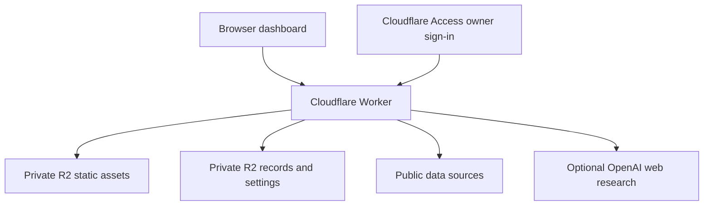

# Brian’s Dash · BDashh

A personal command center that brings planning, portfolio tracking, career discovery, local exploration, and news into one independently hosted web application.

**Built by Brian Uong** · [Source code](https://github.com/Brian-Uong/bdashh-Personal-Dashboard) · [Live dashboard](https://bdashh.com/dashboard/) · [Website controls](https://bdashh.com/owner/settings)

The project began as a way to reduce switching between spreadsheets, job boards, calendars, maps, and news sites. It now runs on its own domain with a Cloudflare Worker backend, persistent storage, owner authentication, and optional server-side AI research. Visitors can explore the published dashboard without a ChatGPT account or subscription; editing and research actions require the owner’s sign-in.

This is a personal project and live demonstration, not a multi-user service. The source repository and live demo are public and can both be shared on a résumé or portfolio. The current release brings the version 73 dashboard to the standalone website while retaining its updated Website controls.

## What the dashboard does

| Area | Capabilities |
| --- | --- |
| Planning | Organize tasks, routines, goals, and saved records in a shared workspace. |
| Portfolio | Track fractional holdings, valuations, saved portfolio history, and stock charts with timestamps and fallback data sources. |
| Career | Maintain job and recruiter leads, search preferences, and source-linked research; refresh public listings and optionally run AI web research. |
| Local discovery | Explore places and maps, find local events, and retain source links, dates, and eligibility details for review. |
| News | Save up to five topics and refresh recent headlines from public feeds without an OpenAI call. Filter duplicates, show partial results honestly, and retain articles when a source fails. Optional AI research is separately controlled. |
| Website controls | Switch public viewing on or off, enable or disable OpenAI requests, and opt into daily research without redeploying. |

Version 73 includes public-feed news refresh and fallback handling, improved career filtering and record retention, an official City of Corona calendar adapter, and stock-history fallback and Eastern time normalization. Public visitors see saved content; they cannot trigger owner-only refreshes or paid AI requests.

## Architecture



| Layer | Implementation |
| --- | --- |
| Frontend | HTML, CSS, browser JavaScript modules, responsive layouts, interactive charts and maps. |
| Backend | JavaScript modules and TypeScript route handlers bundled into a Cloudflare Worker. |
| Authentication | Cloudflare Access sign-in plus server-side verification of the owner’s JWT; writes and paid operations enforce authorization. |
| Persistence | Separate private R2 buckets for application data and versioned static assets; conditional writes protect against concurrent updates. Preview data is isolated. |
| Research | Public-feed and source adapters, with optional OpenAI API web search for briefing, career, and topic research. Keys stay on the server. |
| Delivery | Wrangler dry-run builds, immutable asset manifests, per-file checksums, verified GitHub snapshots, and explicit production releases. |

The standalone application does not depend on a running ChatGPT conversation. ChatGPT subscription benefits do not supply API credits: optional OpenAI features use a separately billed API account. Turning the master AI switch off blocks new paid research and disables daily research. A passive scheduled trigger checks those settings and skips AI and quote work while disabled.

## Engineering highlights

- **Independent deployment:** separated the hosted prototype from its production authentication, storage, and API adapters so the dashboard works on its own domain.
- **Server-enforced authorization:** public viewing and owner editing are distinct. Private assets pass through the verified gateway, and alternate public Worker URLs stay disabled.
- **Reliable updates:** conditional writes, stable record IDs, duplicate detection, cache windows, refresh leases, and last-good-result retention reduce lost edits and misleading results.
- **Provider-aware behavior:** bounded requests, timeouts, source fallback, rate-limit cooldowns, timezone normalization, and visible partial or stale status handle imperfect external data.
- **Controlled releases:** original Site snapshots and standalone source live on separate branches. Release preparation validates source provenance, runs automated checks, and verifies assets before publication.

## Run locally

Requires Node.js **22.13 or newer**, npm, and the dependencies pinned in `package-lock.json`.

```sh
npm ci
npm run dev
```

Open the local URL printed by the preview server. This preview starts with isolated empty data, shows the dashboard UI, and disables writes and Website controls. It does not connect to production storage, execute AI calls, or emulate a complete authenticated production session.

```sh
npm run check     # Source checks, automated tests, and configuration checks
npm run build     # Regenerate asset manifest and compile without deploying
```

For Worker-specific development, `npm run dev:worker` uses Wrangler. Review `wrangler.json` before any Cloudflare-connected command: it contains the existing owner’s deployment configuration. A separate installation requires its own domain, Access policy, buckets, and server-side credentials. Never commit `.dev.vars`, API keys, private settings, or live records.

## Repository guide

| Path | Purpose |
| --- | --- |
| `public/dashboard/` | Interface, styles, browser modules, and vendor assets. |
| `app/api/` | Route handlers for saved records, holdings, news, career, events, and related features. |
| `lib/` | Authentication, storage, settings, research, and provider integrations. |
| `worker/` | Worker entry point and generated asset manifest. |
| `scripts/` | Local preview, checks, source comparison, and release packaging. |
| `tests/` | Regression coverage for authorization, persistence, provider handling, UI behavior, and release tooling. |
| `docs/` | Release workflow, feature notes, and verification evidence. |

`main` holds the standalone website source. `site-source` retains the exact development Site snapshot and its version/commit provenance. Neither branch contains the owner’s live records or API credentials.

## Publishing updates

A website release synchronizes the approved source to GitHub and deploys the matching Worker and assets. Development edits alone do not publish automatically.

1. Retrieve the latest Site version, GitHub branches, and live deployment; reconcile concurrent changes.
2. Preserve owner authentication, production data, secrets, and Website control settings.
3. Run checks and `npm run release:prepare` to produce source, asset, Worker, and validation packets.
4. Verify GitHub file hashes, upload and verify immutable assets, then deploy the matching Worker.
5. Check the live dashboard, protected routes, settings, and data; record the actual release evidence.

See [the release workflow](docs/RELEASE-WORKFLOW.md), [verification record](VERIFICATION.md), and [release status](migration-status.json). Preparation scripts create validated artifacts; they are not an unattended deployment service.

## Scope and limitations

This application serves one owner. It does not implement customer billing, multi-tenant isolation, or general SaaS onboarding. Public mode exposes the owner-approved saved dashboard, so publication is a deliberate choice.

External sources can be unavailable, rate limited, delayed, or incomplete. News cards link to publishers rather than reproduce articles; results are not guaranteed to fill every topic. Career leads and event details require source verification, and market data is informational. Feed adapters serve this personal project; a commercial product would need its own provider and licensing review. See [third-party notices](THIRD-PARTY-NOTICES.md).

## Résumé project summary

**BDashh — Personal Dashboard | JavaScript, TypeScript, Cloudflare Workers, R2, OpenAI API**

- Built and deployed a personal dashboard combining planning, portfolio tracking, career discovery, local events, and topic-based news on an independent custom domain.
- Implemented owner authentication, persistent cloud storage, public read-only access, and server-side controls for optional AI research and API spending.
- Developed resilient data integrations and a release workflow with automated regression checks, versioned assets, checksum verification, and synchronized GitHub source.

These bullets describe implemented capabilities. Add measured outcomes as the project develops.
